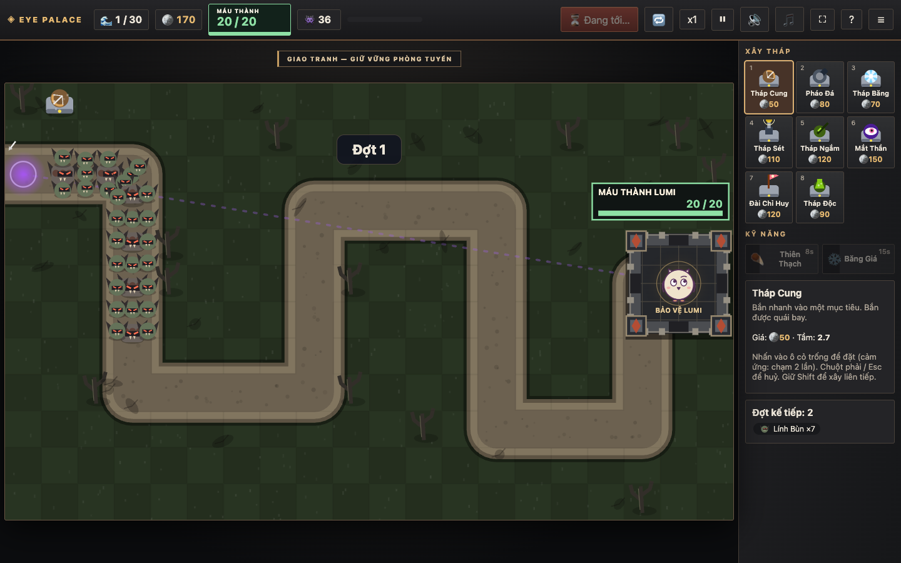

# 👁 Eye Palace – Thủ Thành

Game thủ thành (tower defense) chạy trên trình duyệt. HTML5 Canvas + JavaScript thuần, không cần cài đặt hay build.

## Cách chơi
- Mở `index.html` bằng trình duyệt, hoặc mở bản gộp 1 file `dist/eyepalace.html` (dễ gửi cho người khác).
- Hoặc chạy server tĩnh trong thư mục này: `python3 -m http.server 8765` rồi vào http://127.0.0.1:8765
  – khi chạy qua http, trình duyệt cho phép **cài như ứng dụng** và chơi **offline**.
- Chọn bản đồ, độ khó (và thử thách nếu muốn) → **Bắt đầu**. Xây tháp trên ô cỏ, nâng cấp, gọi đợt quái.
  Trụ qua 30 đợt để thắng (sau đó có thể chơi vô tận). Hoặc chơi **📅 Thử thách hôm nay** – đổi mỗi ngày.
- Liên kết nhanh: `index.html?play=0..7` (bản đồ cố định), `?play=8&seed=N` (bản đồ ngẫu nhiên),
  `?custom=<mã>` (bản đồ tự vẽ được chia sẻ), `&diff=easy|normal|hard`, `#book` (cẩm nang), `#achievements`, `#editor` (trình vẽ).
- Dữ liệu (thành tựu, kỷ lục, ván lưu) nằm trong trình duyệt; xuất/nhập file JSON ở màn **Thành tựu** để chuyển máy.

## Phím tắt (bấm `?` trong game để xem)
| Phím | Chức năng |
|---|---|
| 1–8 | Chọn tháp để xây (giữ Shift để xây liên tiếp) |
| ←↑↓→ / Enter | Di chuyển con trỏ ô / xây – chọn – nhặt rương – thả thiên thạch |
| Space | Gọi đợt kế tiếp (gọi sớm được thưởng vàng) |
| U / S / T | Nâng cấp / Bán (tháp đắt cần bấm 2 lần khi đang đánh) / Đổi mục tiêu |
| Shift+U | Nâng cấp liên tục tới cấp 3 |
| Tab / Shift+Tab | Chọn lần lượt các tháp đã xây |
| Z | Hoàn tác xây/nâng cấp/bán (lúc chuẩn bị, hoàn 100%) |
| Q / W | Kỹ năng Thiên Thạch / Băng Giá |
| R (giữ) | Xem tầm bắn mọi tháp |
| A / F | Tự gọi đợt / Tốc độ x1–x4 |
| P / Esc | Tạm dừng / Huỷ chọn |
| M / N | Âm thanh / Nhạc nền (chỉnh âm lượng trong menu tạm dừng) |
| G / C / H / T | Trong trình vẽ: Gợi ý đường / Cổng mới / Ô nóng / Chủ đề |

## Nội dung
- **Bảo vệ Lumi** (nhân vật gốc từ EyeTank) trong sân thành có tường bao và bốn vọng gác; sân 3×3 ô không xây được. Máu thành thấp làm tường nứt/cháy.
- **Đại lộ ba làn**, rộng hơn trước ~72% tính theo mép đường (79,2 / 46 px); bộ binh tiến theo tổ ba, tổng quái/thưởng mỗi đợt không đổi.
- Mỹ thuật **vây hãm**: thép tối, đồng cháy, cây khô, quái mắt đỏ; báo động khi quái/trùm áp sát hoặc thành còn ≤30% máu. Hỗ trợ giảm chuyển động.
- **8 tháp × 3 cấp + 16 nhánh cấp 4**: Cung, Pháo, Băng, Sét, Ngắm, Mắt Thần, Đài Chỉ Huy (hỗ trợ), Tháp Độc
- **16 loại quái** (có quái thưởng Yêu Tinh Vàng): bay, tàng hình, đào hầm, khiên, hồi máu, tách đôi, phù thủy phá phép… và 3 trùm
  (Chúa Quỷ, Long Vương bay, Vua Nhớt)
- **8 bản đồ cố định** (1–4 cổng, đường giao cắt, Núi Lửa có ô nóng, Cung Điện Mắt mở khoá sau 3 trận thắng) + bản đồ ngẫu nhiên theo mã số + 🛠 **tự vẽ bản đồ** (tối đa 3 cổng, ô nóng, 6 chủ đề, chia sẻ bằng liên kết)
- Đợt đêm tối, đợt hoàn hảo, rương vàng, 2 kỹ năng, gợi ý chiến thuật, báo trước cổng ra quái
- 3 độ khó, 6 thử thách nhân điểm + chế độ 🧪 Thử Nghiệm (vàng vô hạn), sao 1–3⭐, 16 thành tựu, bảng xếp hạng, thống kê trọn đời
- **Nhạc combat điện tử thích ứng**: bass offbeat, kick/breakbeat, snare/hi-hat kép và synth căng; chu kỳ 8 ô nhịp có build-up, ngắt rồi drop. Chuẩn bị 120 BPM, giao tranh 168, trùm 180, nguy cấp 192. Âm lượng nhạc/hiệu ứng chỉnh riêng, nén đỉnh âm khi giao tranh.
- Thời tiết & âm thanh môi trường theo bản đồ, chế độ hiệu ứng thấp cho máy yếu

## Cấu trúc mã
| File | Vai trò |
|---|---|
| `js/config.js` | Số liệu tháp, nhánh, quái, độ khó, kỹ năng, thành tựu, thử thách |
| `js/maps.js` | Bản đồ, đường đi (`Path`), sinh lưới & vật cản, bản đồ ngẫu nhiên |
| `js/entities.js` | `Enemy`, `Tower`, `Projectile` – logic thuần, không DOM |
| `js/waves.js` | Sinh đợt quái, đợt đêm, cổng, gợi ý chiến thuật |
| `js/game.js` | Trạng thái ván chơi, vòng cập nhật, hiệu ứng, điểm, lưu/tải |
| `js/render.js` | Vẽ Canvas 2D |
| `js/audio.js` | Âm thanh, nhạc nền & âm thanh môi trường WebAudio |
| `js/main.js` | Giao diện, nhập liệu, lưu trữ |
| `js/achievements.js` | Thành tựu, thống kê, xếp hạng, cẩm nang, xuất/nhập dữ liệu |
| `sw.js`, `manifest.webmanifest` | Chơi offline / cài như ứng dụng |
| `tools/test.js` | Kiểm thử logic: `node tools/test.js` |
| `tools/audio-check.js` | Đo nhạc bằng WebAudio thật trong Chrome: âm lượng, đỉnh âm, mute, chuyển cấp, dọn nguồn phát |
| `tools/browser-check.js` | Chơi thử trên Chrome: thao tác, nhạc thích ứng, mobile, bản một file |
| `tools/sim.js` | Bot mô phỏng cân bằng: `node tools/sim.js <map 0-8> <diff> <số ván>` (`MODS=…`, `SEED=…`, `CUSTOM=<mã>` với map 9) |
| `tools/perf.js` | Đo hiệu năng tình huống nặng (40 tháp, ~300 quái, x4): `node tools/perf.js [map]` |
| `tools/build.js` | Gộp thành 1 file: `node tools/build.js` → `dist/eyepalace.html` |

Khi sửa JS/CSS, tăng số `?v=` trong `index.html` để trình duyệt tải bản mới.
